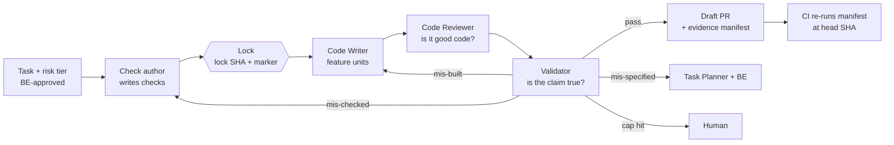

# Verification Loop — proof as the deliverable

> **Status: draft proposal.** The draft pieces exist on this branch: the
> [`neo-evidence-manifest`](../../../plugins/neo-core/skills/neo-evidence-manifest/SKILL.md) skill, the
> [`Neo Validator`](../../../plugins/neo-core/agents/neo.validator.agent.md) agent, and the opt-in
> `guard-locked-checks` hook. **None of it is wired into the Coding loop yet.** § Rollout lists what
> has to change before it gates anything. Boundaries 2 and 3 stay `[target]` in
> [process-flow.md](../../concepts/process-flow.md) until that lands.

Terms in **bold** are defined in the [glossary](../../glossary.md). This is a *design* doc: the
why, plus a proposal. The skill is the normative definition of evidence; this doc doesn't restate
it.

---

## Why specs aren't enough

- A spec says what we *want*. It doesn't prove what we *got*. An agent can satisfy the letter of a
  spec and miss its intent.
- At agent speed, human code review stops scaling. Generation is cheap; trust is the bottleneck.
- Specs drift. Agents edit code faster than anyone updates the spec.

Neo already leans this way. [architecture.md](../../concepts/architecture.md) says "the build is
not the point; the proof is," and task-sized specs exist so that a machine can validate them. What
Neo lacks is the machinery: today the **validation criteria** on a task are checked by the same
crew that built it, and the only artifact that crosses Boundary 2 is a PR with a summary that says
it works.

## The shift

From "did the agent follow the spec?" to "can the agent prove the result is correct?"

- **Verification becomes the primary artifact.** The spec is an input; the evidence is the
  deliverable.
- **Every change ships with its proof**: tests, property checks, contracts, traces, eval results.
- **The model never certifies its own work.** Deterministic tools and an independent agent do.

## The core rule holds

**Verify features, validate tasks. Humans verify, machines validate.** This proposal keeps that
axiom. Everything below is **validation**: machine evidence that a task meets its criteria. It
feeds **verification** at Boundary 3 but doesn't replace it. The Business Engineer still runs the
feature's verification steps and still owns the judgment.

What changes is *where human attention goes*. Humans stop reviewing code line by line for
correctness and start reviewing **verification strategy**: which risk tier a task gets, which
evidence layers it needs, and whether a check really expresses its criterion.

---

## The mechanism

Five moves, each assigned to a Neo artifact.

### 1. Separate the builder from the verifier

| | Builder (`Neo Code Writer`) | Verifier (`Neo Validator`) |
| --- | --- | --- |
| Model | Sonnet | Opus, then a different family. Deliberately not the builder's model |
| Sees | The plan, the unit, the area | The task, the diff, the locked checks. **Not** the plan, the writer's reports, or the reviewer's verdict |
| Job | Make it work | **Break the claim** that it works |
| Output | A commit | An evidence manifest |

The validator gets less context on purpose, so it can't inherit the builder's reasoning or its
blind spots. If an orchestrator hands it the builder's narrative anyway, it ignores it and says so.

`Neo Code Reviewer` stays. Review asks *is this good code?* (conventions, design, safety).
Validation asks *is this claim true?* Different questions, different agents.

### 2. Write the proof obligations first

Before any feature code, a separate agent instance turns each validation criterion into
executable checks: unit tests, property-based tests (Hypothesis, fast-check, FsCheck),
contracts, formal specs, and policy rules. The commit that adds them is the **lock**.

- The builder may read locked checks and must make them pass. It may not change them.
- `guard-locked-checks` (opt-in `preToolUse` hook) denies edits, shell writes, commits, and pushes
  that touch the locked paths while the lock marker is present.
- The hook is a **speed bump**. Shell matching is bypassable, and a fail-closed hook has bricked
  Neo sessions before ([enforcement.md](../guides/enforcement.md)). The **control** is the
  validator's integrity audit, `git diff <lock>..<head> -- <locked paths>`, and eventually a CI job
  that repeats it.
- A wrong locked check is a spec problem. Changing it takes a human-approved **lock amendment**,
  recorded in the manifest.

This also settles the open drift in [process-flow.md § Boundary 2](../../concepts/process-flow.md#boundary-2--coding--verification)
(phase-separated vs interleaved testing). The answer is neither: **checks first and locked, then
feature units, then an independent run.**

### 3. Layer the evidence by risk

| Kind | Examples | Decided by |
| --- | --- | --- |
| **Deterministic** | Tests, type checks (pyright, tsc), linters, SAST, property tests, policy-as-code, mutation samples | A tool's exit code |
| **Semantic** | The validator checks intent against the spec and flags gaps no test covers | An independent agent, and **only to demote**: a finding can block a criterion, never prove one |
| **Formal**, where risk justifies it | Dafny, TLA+, Lean, contracts. An agent may draft them | The checker's yes/no, which isn't up to the model |

Which layers a task needs comes from its **risk tier** (T0–T3, defined in the skill). The BE
approves the tier with the task set at Boundary 1. That is where a human reviews verification
strategy.

The skill's proof rule is what gives "proven" its teeth. A criterion is proven only by a check
that was **locked before implementation, passes at head, fails at base, and ran clean from the
committed tree**. "Fails at base" catches the most common way agent-written tests lie: they pass
no matter what.

### 4. One evidence bundle per change

The **evidence manifest** (skill § The manifest) is a Markdown summary plus a machine-readable
JSON block in the PR body. It links requirement → criteria → checks → results at base and head
→ integrity audit → validator findings. It is the deliverable and what the merge gate evaluates.

At Boundary 3, the task manifests roll up into a feature **evidence pack** for the BE. It maps
each verification step to the machine evidence behind it, so the BE's judgment goes first to the
steps where machine proof is thin.

### 5. Close the loop

- A failed manifest goes back to the builder **with the evidence** (the failing check, command,
  output, and finding), not "fix it."
- **Retries are capped**: three attempts, or the same failure twice with no change, then escalate
  to a human with every attempt's manifest.
- Failures are routed by diagnosis (**mis-built**, **mis-checked**, **mis-specified**), the same
  shape as the Boundary 3 triage, at task grain.
- **Findings ledger.** Every validator finding is marked `confirmed` or `refuted` once a human
  settles it. Precision, escapes, and per-kind yield tune the validator's instructions from
  evidence, not anecdotes.

---

## The flow at Boundary 2

The revised Boundary 2 gate: **the manifest verdict is `pass`, and a machine has re-run it.**
Code review approval stays a precondition. "Merge gates on evidence, not on approval clicks."

---

## Enterprise implications

- **Auditability.** The manifest and the squash-commit trace
  ([process-flow.md § Traceability under squash](../../concepts/process-flow.md#traceability-under-squash))
  give regulated teams a chain from requirement to evidence: PRD segment → feature → task →
  criteria → checks → results → the human who approved the tier and any amendment.
- **Humans review strategy, not code.** Tier approval at Boundary 1, lock amendments, and the
  evidence pack at Boundary 3 are where the human sits. Line-by-line review becomes optional for
  T0–T1 and stays mandatory where the tier says so.
- **Neo's own agents, skills, and hooks need the same treatment.** A prompt is code that ships.
  Neo already validates structure (`scripts/validate-plugins.py`) and checks that the plugin loads.
  The next step is behavioral:
  - **Hook tests**: a payload-in/decision-out suite like the one used to build
    `guard-locked-checks`, run in CI on both bash and PowerShell.
  - **Validator evals**: golden tasks with seeded defects (a test that passes at base, a moved
    goalpost, a missing edge case). Measure recall of planted defects and precision on clean
    changes, and gate prompt changes on it.
  - **Tool-selection and alignment evals**: does the agent reach for `execute` when told to
    search, refuse to edit locked checks, and stay inside its unit?

---

## Rollout

What exists on this branch, and what has to happen before it gates anything:

| # | Change | State |
| --- | --- | --- |
| 1 | `neo-evidence-manifest` skill: proof rule, tiers, integrity, manifest, ledger | **Draft (this branch)** |
| 2 | `Neo Validator` agent: independent, read-only, falsification-framed | **Draft (this branch)**, user-invocable, not delegated to |
| 3 | `guard-locked-checks.{sh,ps1}`: opt-in lock guard, unregistered | **Draft (this branch)** |
| 4 | `neo-task-authoring` + task handoff schema: a `Risk tier` field (BE-approved) | Not started |
| 5 | `Neo Implementation Planner`: emit **check units first**, marked as the lock set | Not started |
| 6 | `Neo Technical Engineer`: check-author step → lock → build → review → validate; retry cap; write and remove the lock marker; put the manifest in the PR | Not started |
| 7 | CI gate: a reusable workflow that parses `<!-- neo:evidence v0 -->`, re-runs commands at `head_sha`, and fails on any mismatch | Not started |
| 8 | Evidence pack assembly for Boundary 3 (likely `Neo Business Engineer`) | Not started |
| 9 | Findings ledger storage and analysis, alongside `scripts/analyze_agent_logs.py` | Not started |
| 10 | Validator eval suite (seeded-defect golden tasks) | Not started |

Order matters: 4 and 5 before 6, because the orchestrator can't lock checks the planner never
separated out. 7 is what turns the manifest from an agent's claim into evidence.

## Open questions

1. **Who authors the checks?** A fresh `Neo Code Writer` instance with a "check unit" label is the
   smallest change. A dedicated check-author agent would isolate it better. Is the extra role worth it?
2. **Where does the findings ledger live?** PR comments are visible but hard to aggregate; a
   repo-level JSONL is easy to aggregate but is a write the agents must not forge.
3. **Is three the right retry cap**, and should it vary by tier?
4. **Does this address [G3](./framework-gap-analysis.md)?** At task grain, yes: the validator is
   adversarial by construction and "fails at base" is a falsification test. At Boundary 3 the BE's
   question is still confirmatory. The evidence pack's "read first" list points the BE at the
   weakest proof, which helps, but isn't a falsification frame.
5. **Mode B.** Under flags, does "fails at base" mean flag-off at head rather than the base SHA?

---

> **Specs tell agents what to build. Proof tells us we can trust what they built.** A chatbot needs
> instructions; a digital workforce needs accountability.

## Related

- [`neo-evidence-manifest`](../../../plugins/neo-core/skills/neo-evidence-manifest/SKILL.md): the normative definition of evidence.
- [process-flow.md](../../concepts/process-flow.md): Boundaries 2 and 3 this proposal would fill in.
- [enforcement.md § Locked checks](../guides/enforcement.md#locked-checks): opting in to the lock guard.
- [framework-gap-analysis.md](./framework-gap-analysis.md): G3, falsification-framed verification.
